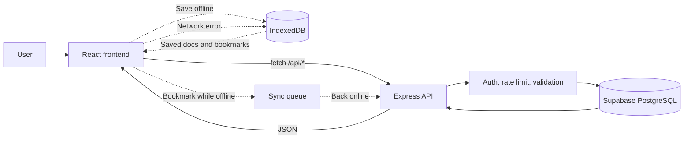

<div align="center">

<picture>
  <source media="(prefers-color-scheme: dark)" srcset="frontend/src/assets/DevVault-Logo2.png" />
  
</picture>

# DevVault

### Your personal documentation hub for guides, commands, and troubleshooting notes


**[🌐 Live Demo](devvault-stack.netlify.app)**

<!-- Replace with a real screenshot or GIF of the app -->
<!--  -->

</div>

---

## 📖 About

**DevVault** is a personal documentation hub for storing and organizing **development guides, installation steps, commands, configurations, and troubleshooting notes**. Instead of searching the web every time you set up a tool, you keep your own reliable notes in one place and build a knowledge base you can reuse across projects.

It is a full-stack app with a **React + Vite** frontend, an **Express + PostgreSQL (Supabase)** backend, JWT authentication with email OTP verification, an admin dashboard, and an **offline mode** so your notes stay available without a connection. It is also an **installable Progressive Web App (PWA)**, so you can add it to your desktop or phone and open it like a native app.

The built-in knowledge base ships with ready-made guides for **React, Tailwind CSS, Node.js, Express, PostgreSQL, Supabase, authentication, Git, and deployment**.

**Example things you can look up**

> *"How do I install PostgreSQL on Windows and add it to my PATH?"*
> *"What does the JWT authentication flow look like in Express?"*
> *"How do I deploy a Vite app to Vercel without 404 errors on refresh?"*

> [!NOTE]
> Documents are written by the admin and stored in your own database. DevVault does not generate content automatically, so a guide is only as current as the last time it was edited. Always check official documentation for the latest steps.

## 📑 Table of Contents

- [Features](#-features)
- [How It Works](#-how-it-works)
- [Tech Stack](#%EF%B8%8F-tech-stack)
- [Project Structure](#-project-structure)
- [Getting Started](#%EF%B8%8F-getting-started)
- [Environment Variables](#-environment-variables)
- [Database](#%EF%B8%8F-database)
- [API Reference](#-api-reference)
- [Authentication & Roles](#-authentication--roles)
- [Offline Support](#-offline-support)
- [Install as an App (PWA)](#-install-as-an-app-pwa)
- [Testing](#-testing)
- [Deployment](#-deployment)
- [Security & Privacy](#-security--privacy)
- [Known Limitations](#%EF%B8%8F-known-limitations)
- [Roadmap](#-roadmap)
- [Author](#-author)

## ✨ Features

**Documentation**
- 📚 Browse documents by **category** or **tag**
- 🔎 Search across titles and descriptions, with a `Ctrl + K` shortcut from anywhere
- 🧾 Step-by-step document pages with copyable **code blocks**, callouts, and an "On this page" table of contents
- 🧩 Technology icons for categories, documents, and tags (React, Node.js, PostgreSQL, Tailwind, and more)
- 👍 "Was this helpful?" feedback on every document

**Accounts**
- 🔖 **Bookmarks** to save favorite documents
- 🕘 **Recently viewed** history
- ✉️ Email signup with a **6-digit OTP verification code**
- 🔑 **Forgot / reset password** with an emailed code

**Installable app (PWA)**
- 📲 **Install DevVault** on desktop, Android, and iOS and launch it from your home screen or app menu
- 🪟 Opens in its own standalone window, without browser tabs or an address bar
- ⚡ Faster repeat loads from cached app files

**Offline mode**
- 📥 One click to **save all documents for offline use** (stored in IndexedDB)
- 📴 Offline fallback for documents, categories, tags, search, and bookmarks
- 🔄 Bookmark changes made offline are **queued and synced** when you reconnect
- 🚦 Status banner for offline mode and pending syncs

**Interface**
- 🌙 Light and dark themes, dark by default and remembered between visits
- 📱 Responsive layout with a mobile sidebar drawer
- ⏳ Animated loading screen after login

**Admin**
- 📊 Dashboard with totals and most viewed documents
- 🗂️ Manage documents and users (delete documents, grant or revoke admin)
- ➕ Create new documents from the UI

## 🧠 How It Works

The frontend talks to the Express API, which reads from Supabase. When the connection drops, the API client falls back to the copy saved in the browser.



1. **Browse:** pages request data through `lib/api.js`, which calls the REST API.
2. **Protect:** protected routes pass through JWT checks. Admin routes re-check the role in the database on every request.
3. **Install:** the app ships a web manifest and a service worker, so browsers offer to install it and can load the app shell without a network.
4. **Save offline:** `Save offline` downloads every document through `/api/documents/offline/bundle` into IndexedDB.
5. **Fall back:** if a request fails because the browser is offline, the same call is answered from the saved copy.
6. **Sync:** bookmark changes made offline are queued per document and replayed automatically when the connection returns.

## 🛠️ Tech Stack

| Layer | Technologies |
|---|---|
| **Frontend** | React 19, Vite, React Router 7, Tailwind CSS 4, Lucide & React Icons |
| **Backend** | Node.js, Express 5, `express-validator`, `express-rate-limit`, `helmet`, `cors`, `dotenv`, `slugify` |
| **Database** | PostgreSQL hosted on Supabase, accessed with `pg` |
| **Auth & Email** | JWT (HS256), `bcryptjs`, Nodemailer (email OTP) |
| **PWA & Offline** | `vite-plugin-pwa` (web manifest and service worker), IndexedDB, custom bookmark sync queue |
| **Deployment** | Netlify (frontend), Render (backend), Supabase (database) |

## 📂 Project Structure

```text
devvault/
├── backend/
│   ├── schema.sql                  # Base database schema
│   ├── test-mail.js                # SMTP connection test script
│   ├── test/
│   │   └── passwordReset.test.js   # Password reset tests (node:test)
│   ├── src/
│   │   ├── index.js                # Express app entry point
│   │   ├── config/
│   │   │   ├── db.js               # PostgreSQL pool
│   │   │   ├── migrate.js          # Applies schema.sql and migrations/
│   │   │   ├── migrations/         # add_email_verification.sql, add_password_reset.sql
│   │   │   ├── seed.js             # Seeds categories, tags, docs, admin and demo users
│   │   │   ├── seedData.js         # Categories, tags, and base documents
│   │   │   └── *Docs.js            # Seed documents (react, tailwind, auth, database, deployment)
│   │   ├── middleware/
│   │   │   └── auth.js             # requireAuth, optionalAuth, requireAdmin
│   │   ├── routes/
│   │   │   ├── auth.js             # Signup, login, OTP, password reset
│   │   │   ├── categories.js
│   │   │   ├── documents.js
│   │   │   ├── bookmarks.js
│   │   │   ├── recent.js
│   │   │   ├── admin.js
│   │   │   └── misc.js             # Tags
│   │   └── services/
│   │       ├── mailer.js           # Nodemailer wrapper
│   │       ├── otp.js              # Email verification codes
│   │       └── passwordReset.js    # Password reset codes
│   ├── .env.example
│   └── package.json
│
├── frontend/
│   ├── src/
│   │   ├── components/             # Sidebar, Topbar, CodeBlock, DocIcon, RightRail, SyncBanner
│   │   ├── constants/              # Tag slug to icon mapping
│   │   ├── context/                # AuthProvider, ThemeContext
│   │   ├── hooks/                  # useAuth, useOnlineStatus, useOfflineSync, usePendingSyncCount
│   │   ├── lib/
│   │   │   ├── api.js              # API client with offline fallbacks
│   │   │   ├── offlineStore.js     # IndexedDB storage and bookmark queue
│   │   │   └── offlineSync.js      # Offline bundle download and refresh
│   │   ├── pages/                  # Home, DocPage, Categories, Tags, Bookmarks, Recent,
│   │   │                           # Login, Signup, VerifyEmail, ForgotPassword, ResetPassword,
│   │   │                           # NewDocument, AdminDashboard
│   │   ├── App.jsx
│   │   ├── index.css               # Tailwind and light/dark theme tokens
│   │   └── main.jsx
│   ├── vite.config.js              # Vite, React, Tailwind, and PWA plugin setup
│   ├── .env.example
│   └── package.json
│
└── README.md
```

## ⚙️ Getting Started

### Prerequisites

- [Node.js](https://nodejs.org/) (current LTS) and npm
- Git
- A free [Supabase](https://supabase.com) account (hosts the PostgreSQL database)
- An SMTP account for verification emails (optional in development)

### Installation

```bash
# 1. Clone the repository
git clone https://github.com/janrelle24/devVault.git
cd devvault

# 2. Install backend dependencies
cd backend
npm install

# 3. Install frontend dependencies
cd ../frontend
npm install
```

### Create the Supabase database

1. Sign up at [supabase.com](https://supabase.com) and click **New project**.
2. Choose a region close to your backend and set a **database password**. Save it, because you need it for `DATABASE_URL`.
3. Wait for provisioning to finish, then click **Connect** at the top of the dashboard.
4. Copy the **Session pooler** connection string (port `5432`). It works over IPv4, so it is the safest choice for Render or your own computer.
5. Replace `[YOUR-PASSWORD]` with your real password. URL-encode special characters such as `@` (`%40`) or `#` (`%23`).

The default Supabase database is named `postgres`, so you do not need to create a `devvault` database.

### Environment variables

**`backend/.env`**

```env
PORT=4000
NODE_ENV=development
CLIENT_ORIGIN=http://localhost:5173

DATABASE_URL=postgresql://postgres.<project-ref>:YOUR_PASSWORD@aws-0-<region>.pooler.supabase.com:5432/postgres

JWT_SECRET=replace_with_a_random_string_of_at_least_32_characters
JWT_EXPIRES_IN=7d

ADMIN_NAME=Your Name
ADMIN_EMAIL=you@example.com
ADMIN_PASSWORD=use_a_strong_password
```

**`frontend/.env`**

```env
VITE_API_URL=http://localhost:4000
```

> [!WARNING]
> Never commit your `.env` files. Make sure your `.gitignore` includes:
> ```gitignore
> .env
> node_modules/
> ```

See [Environment Variables](#-environment-variables) for the full list, including email settings.

### Create the tables and seed data

```bash
cd backend
npm run db:migrate
npm run db:seed
```

### Run locally

Use two terminals.

```bash
# Terminal 1: backend (http://localhost:4000)
cd backend
npm run dev
```

```bash
# Terminal 2: frontend (http://localhost:5173)
cd frontend
npm run dev
```

Open **http://localhost:5173**.

> [!TIP]
> Leave `SMTP_HOST` empty while developing. Verification and reset codes are printed in the backend console instead of being emailed.

### Default accounts

After seeding:

| Account | Credentials |
|---|---|
| **Admin** | The `ADMIN_EMAIL` and `ADMIN_PASSWORD` from your `.env` |
| **Demo user** | `demo@devvault.dev` / `password123` |

> [!WARNING]
> Change the demo password or remove the demo account before sharing a deployed site publicly.

### Available scripts

**Backend**

| Command | Description |
|---|---|
| `npm run dev` | Start with nodemon (auto restart) |
| `npm start` | Start in production mode |
| `npm run db:migrate` | Apply `schema.sql` and all migrations |
| `npm run db:seed` | Seed categories, tags, documents, admin and demo users |
| `npm test` | Run the test suite (`node --test`) |

**Frontend**

| Command | Description |
|---|---|
| `npm run dev` | Start the Vite dev server |
| `npm run build` | Production build into `dist/` |
| `npm run preview` | Preview the production build |
| `npm run lint` | Run ESLint |

## 🔑 Environment Variables

### Backend (`backend/.env`)

| Variable | Required | Description |
|---|:---:|---|
| `DATABASE_URL` | Yes | Supabase **Session pooler** connection string |
| `JWT_SECRET` | Yes | Secret for signing tokens. **At least 32 characters** |
| `CLIENT_ORIGIN` | Yes | Exact frontend URL allowed by CORS, no trailing slash |
| `PORT` | No | Server port (default `4000`) |
| `NODE_ENV` | No | `development` or `production` |
| `JWT_EXPIRES_IN` | No | Token lifetime (default `7d`) |
| `ADMIN_NAME` | Seed | Display name for the seeded admin |
| `ADMIN_EMAIL` | Seed | Email for the seeded admin |
| `ADMIN_PASSWORD` | Seed | Password for the seeded admin |
| `SMTP_HOST` | No | SMTP server. If empty in development, codes are printed to the console |
| `SMTP_PORT` | No | SMTP port (default `587`) |
| `SMTP_SECURE` | No | `true` for port 465 |
| `SMTP_USER` / `SMTP_PASS` | No | SMTP credentials |
| `MAIL_FROM` | No | Sender, for example `"DevVault <no-reply@yourdomain.com>"` |
| `OTP_SECRET` | No | Secret used to hash codes (falls back to `JWT_SECRET`) |

Generate a strong secret with:

```bash
node -e "console.log(require('crypto').randomBytes(64).toString('hex'))"
```

### Frontend (`frontend/.env`)

| Variable | Description |
|---|---|
| `VITE_API_URL` | Base URL of the backend, such as `http://localhost:4000`. A trailing `/` or `/api` is stripped automatically |

Vite bakes this value in at build time, so redeploy the frontend after changing it. Never put secrets in `VITE_` variables.

## 🗄️ Database

The schema lives in `backend/schema.sql`, with incremental changes in `backend/src/config/migrations/`. `npm run db:migrate` applies the schema first, then every `.sql` migration in alphabetical order. All statements are idempotent, so you can run it repeatedly.

| Table | Purpose |
|---|---|
| `users` | Accounts, roles (`user` / `admin`), OTP and password reset fields |
| `categories` | Document categories with icon and sort order |
| `documents` | Documents with a JSONB `content` array, view and feedback counters |
| `tags` / `document_tags` | Many-to-many document tagging |
| `bookmarks` | A user's saved documents |
| `recently_viewed` | A user's view history |
| `document_feedback` | Helpful / not helpful votes (one per logged-in user per document) |

A full-text search index (GIN) covers document titles and descriptions, and a trigger keeps `updated_at` current.

### Document content format

A document's `content` is a JSON array of sections. Every field except `type` is optional:

```json
[
  {
    "type": "section",
    "heading": "1. Install dependencies",
    "text": "Install the default packages.",
    "code": { "lang": "bash", "value": "npm install" },
    "callout": { "tone": "success", "text": "You should see no errors." }
  }
]
```

Documents and categories use an `icon` key such as `react`, `nodejs`, `postgresql`, `jwt`, `rocket`, or `bug`. The full list is in `frontend/src/components/DocIcon.jsx`, and tag icons are mapped in `frontend/src/constants/tagIcons.js`.

To add more built-in documents, create or edit a file in `backend/src/config/`, add it to `extraDocs` in `seedData.js`, and run `npm run db:seed` again. Seeding is safe to repeat because it upserts by slug.

### Supabase notes

- **Connection string:** use the **Session pooler** string. The pooler username has the form `postgres.<project-ref>`, not just `postgres`.
- **Browse your data:** open **Table Editor** in the Supabase dashboard, or **SQL Editor** to run queries.
- **Row Level Security:** tables created with SQL have RLS off by default, so they can be readable through Supabase's public API using the anon key. Enable RLS on every table after migrating. The backend connects as the `postgres` role, which bypasses RLS, so DevVault keeps working while the public API stays locked down.

```sql
ALTER TABLE users ENABLE ROW LEVEL SECURITY;
ALTER TABLE categories ENABLE ROW LEVEL SECURITY;
ALTER TABLE tags ENABLE ROW LEVEL SECURITY;
ALTER TABLE documents ENABLE ROW LEVEL SECURITY;
ALTER TABLE document_tags ENABLE ROW LEVEL SECURITY;
ALTER TABLE bookmarks ENABLE ROW LEVEL SECURITY;
ALTER TABLE recently_viewed ENABLE ROW LEVEL SECURITY;
ALTER TABLE document_feedback ENABLE ROW LEVEL SECURITY;
```

- **Free plan:** projects may be paused after inactivity. If the backend suddenly cannot connect, restore the project from the dashboard.
- **Common connection errors:**

| Error | Fix |
|---|---|
| `ENOTFOUND` / `ENETUNREACH` | You are using the direct (IPv6) host. Switch to the Session pooler string |
| `Tenant or user not found` | The username is missing `.<project-ref>`. Copy the string again from the dashboard |
| `password authentication failed` | Wrong password or an unencoded special character. Reset it under **Project Settings, Database** |

## 🔌 API Reference

All routes are prefixed with `/api`. Protected routes expect an `Authorization: Bearer <token>` header. Errors return `{ "error": "message" }`.

### Auth

| Method | Route | Access | Description |
|---|---|---|---|
| `POST` | `/auth/signup` | Public | Create an account and email a verification code |
| `POST` | `/auth/verify-email` | Public | Verify email with the 6-digit code |
| `POST` | `/auth/resend-otp` | Public | Resend the verification code |
| `POST` | `/auth/login` | Public | Log in and receive a JWT (`403 EMAIL_NOT_VERIFIED` if unverified) |
| `POST` | `/auth/forgot-password` | Public | Email a reset code (always responds the same way) |
| `POST` | `/auth/reset-password` | Public | Set a new password using the code |
| `GET` | `/auth/me` | User | Current user profile |

**Example: login**

```json
{
  "email": "demo@devvault.dev",
  "password": "password123"
}
```

```json
{
  "token": "<jwt>",
  "user": {
    "id": "b3f1c2a4-0d7e-4a55-9a1c-2f6a5e8d9c10",
    "name": "Demo User",
    "email": "demo@devvault.dev",
    "role": "user"
  }
}
```

### Documents

| Method | Route | Access | Description |
|---|---|---|---|
| `GET` | `/documents` | Public | Search and filter. Query: `search`, `category`, `tag` (max 50 results) |
| `GET` | `/documents/offline/bundle` | Public | All documents with full content, for offline saving |
| `GET` | `/documents/:slug` | Public | Full document. Tracks views, recently viewed, and bookmark state when logged in |
| `POST` | `/documents` | Admin | Create a document |
| `PATCH` | `/documents/:slug` | Admin | Update a document |
| `DELETE` | `/documents/:slug` | Admin | Delete a document |
| `POST` | `/documents/:slug/feedback` | Public | Submit `{ "helpful": true }` or `false` |

### Categories and tags

| Method | Route | Access | Description |
|---|---|---|---|
| `GET` | `/categories` | Public | List categories with document counts |
| `GET` | `/categories/:slug` | Public | A category and its documents |
| `POST` | `/categories` | Admin | Create a category |
| `PATCH` | `/categories/:slug` | Admin | Update a category |
| `DELETE` | `/categories/:slug` | Admin | Delete a category |
| `GET` | `/tags` | Public | List all tags |
| `POST` | `/tags` | Admin | Create a tag |

### Bookmarks and recently viewed

| Method | Route | Access | Description |
|---|---|---|---|
| `GET` | `/bookmarks` | User | List bookmarks |
| `POST` | `/bookmarks/:slug` | User | Add a bookmark |
| `DELETE` | `/bookmarks/:slug` | User | Remove a bookmark |
| `GET` | `/recent` | User | Latest 20 recently viewed documents |
| `DELETE` | `/recent` | User | Clear history |
| `DELETE` | `/recent/:documentId` | User | Remove one entry |

### Admin

| Method | Route | Access | Description |
|---|---|---|---|
| `GET` | `/admin/stats` | Admin | User, document and category counts plus top documents |
| `GET` | `/admin/documents` | Admin | All documents with view counts |
| `GET` | `/admin/users` | Admin | All users |
| `PATCH` | `/admin/users/:id/role` | Admin | Change a user's role (`user` or `admin`) |

### `GET /api/health`

Health check. Returns `{ "status": "ok", "time": "<ISO timestamp>" }`.

**Common status codes**

| Status | Meaning |
|---|---|
| `400` | Validation failed |
| `401` | Missing, invalid, or expired token |
| `403` | Not an admin, or email not verified |
| `404` | Resource not found |
| `409` | Duplicate (existing email, title, or feedback) |
| `429` | Too many requests |
| `500` | Server error |

## 🔐 Authentication & Roles

- Passwords are hashed with **bcrypt** (12 rounds) and must be 8 to 72 characters.
- Public signup **always** creates a regular `user`. Admin accounts come from the seed script or from an existing admin promoting a user.
- New accounts must verify their email with a 6-digit code before logging in. Codes are stored as HMAC hashes, expire after **10 minutes**, allow **5 attempts**, and have a **60 second** resend cooldown.
- Password reset follows the same pattern with separate hashes, and a successful reset also marks the email as verified.
- Admin checks read the role from the **database** on every request, not from the token, so revoking admin takes effect immediately. The last remaining admin cannot be demoted, and admins cannot remove their own role.
- On the frontend, `ProtectedRoute` only improves the experience. All real enforcement happens on the backend.

## 📴 Offline Support

1. Click **Save offline** in the top bar. The app downloads every document and category and stores them in IndexedDB (`devvault-offline`).
2. If a request fails because you are offline, the API client falls back to the saved copy for documents, categories, tags, search, and bookmarks.
3. Bookmark changes made offline go into a queue (one entry per document, latest wins) and are replayed when the connection returns. **Retry now** in the sync banner triggers it manually.
4. If you have saved once before, the offline copy refreshes automatically when it is older than 24 hours.
5. Logging out clears the queue and local bookmark mirror so the next person on the computer sees none of it.

## 📲 Install as an App (PWA)

DevVault is an installable Progressive Web App, so there is nothing to download from an app store.

| Platform | How to install |
|---|---|
| **Chrome / Edge (desktop)** | Click the install icon in the address bar, or open the browser menu and choose **Install DevVault** |


Once installed, DevVault opens in its own window and its app files are cached by the service worker. Combine it with **Save offline** to read your documents with no connection at all.

> [!NOTE]
> Installing requires **HTTPS** (`localhost` is allowed for development). The service worker is most reliable in a production build, so to test installation locally run `npm run build` followed by `npm run preview` in the `frontend` folder.

> [!TIP]
> After deploying a new version, installed copies pick up the update the next time they are opened with a connection. Close and reopen the app if you do not see the latest changes.

Logging out also clears the cached API responses (`devvault-api`) on the device, so the next person on the computer sees none of your data.

## 🧪 Testing

```bash
cd backend
npm test
```

The password reset suite uses Node's built-in test runner with a mocked database and mailer. It covers hashed code storage, single-use codes under concurrent requests, the five-attempt cap, expired codes, and cleanup when email delivery fails.

To check your SMTP settings:

```bash
node test-mail.js you@example.com
```

## 🚀 Deployment

| Service | Platform | Configuration |
|---|---|---|
| **Frontend** | Netlify | Root directory: `frontend` · Framework: Vite · Build command: `npm run build` · Output directory: `dist` · Env: `VITE_API_URL` |
| **Backend** | Render | Root directory: `backend` · Build command: `npm install` · Start command: `npm start` · Env: `DATABASE_URL`, `JWT_SECRET`, `CLIENT_ORIGIN`, `NODE_ENV`, SMTP variables |
| **Database** | Supabase | Session pooler connection string as `DATABASE_URL` |

Run `npm run db:migrate` and `npm run db:seed` once against your Supabase database (set `DATABASE_URL` in your terminal first if your local `.env` points elsewhere).

Because the app uses client-side routing, add `frontend/netlify.json` so page refreshes do not return 404:

```json
{
  "rewrites": [{ "source": "/(.*)", "destination": "/index.html" }]
}
```

**Final step:** set `CLIENT_ORIGIN` on the backend to your Netlify URL (exact match, no trailing slash) and redeploy the backend.

> [!NOTE]
> PWA installation needs HTTPS, which Netlify and Render provide automatically. Free Render services sleep when idle, so the first request after a while can take about a minute. Vite variables are baked in at build time, so redeploy the frontend after changing `VITE_API_URL`.

**Production checklist**

- [ ] New, long, random `JWT_SECRET` and a strong admin password
- [ ] `.env` is in `.gitignore` and was never committed
- [ ] `CLIENT_ORIGIN` is locked to your frontend URL
- [ ] SMTP is configured so verification codes are actually delivered
- [ ] Row Level Security is enabled on every Supabase table
- [ ] Demo account removed or its password changed

## 🔒 Security & Privacy

- Helmet sets secure HTTP headers, and CORS is restricted to `CLIENT_ORIGIN`
- Rate limits: 300 requests per 15 minutes across the API, and 10 per 15 minutes on signup, login, OTP, and reset routes
- All SQL uses parameterized queries
- Request bodies are limited to 1 MB and validated with `express-validator`
- Passwords are hashed with bcrypt, and verification codes are stored only as HMAC hashes
- Forgot-password and resend-code responses never reveal whether an email is registered
- Login returns one generic error for an unknown email and a wrong password
- Admin access is checked against the database on every admin request
- Secrets live only in environment variables and are never sent to the browser
- Logging out clears locally saved bookmark data on the device
- When hosting behind a proxy such as Render, add `app.set('trust proxy', 1)` so rate limiting sees real client IPs

## ⚠️ Known Limitations

- Documents can be created from the UI but not edited or categorized with tags and icons there yet. The `PATCH` endpoint exists, but there is no editor.
- Online search covers titles and descriptions only, while the offline search also matches section text.
- The JWT is kept in `localStorage`, so protecting against XSS matters. HttpOnly cookies would be the more secure option.
- Installed copies update when reopened with a connection, so users may need to close and reopen the app to see a new version.
- The offline copy is saved manually (and refreshed daily once enabled), so it can lag behind new edits.
- The "View Troubleshooting" button in the document sidebar is not wired up yet.
- Only the password reset flow has automated tests.


## 🎯 Project Goals

DevVault aims to turn scattered setup notes into one searchable, reliable knowledge base that works anywhere, even offline. It also demonstrates practical work in full-stack development, REST API design, PostgreSQL schema design, authentication and authorization, email OTP flows, offline-first web apps, responsive UI, and cloud deployment.

## 👨‍💻 Author

**Janrelle Lubiano**
Computer Science · Full-Stack Development · AI Applications

[](https://github.com/janrelle24)
[](http://www.linkedin.com/in/janrelle-lubiano-69074b222)

---

<div align="center">

⭐ If you find this project useful, consider giving it a star.

*This project is for educational and demonstration purposes.*

</div>
